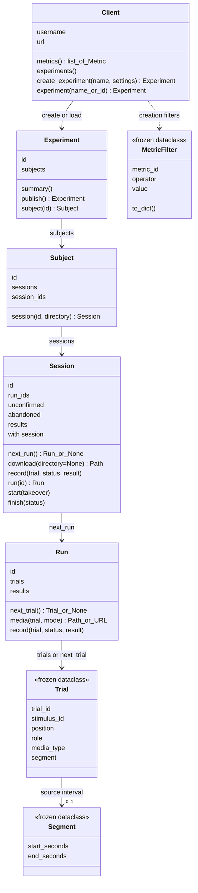

# API objects

`dbstim.connect()` asks for your password and returns a `Client` signed in to
**dbstimuli.com** (`url=` selects another server). Arrows show how you get each
object.

Signatures are shortened; creation settings are keyword arguments.
`experiment("Exact name")` prefers the latest published revision; if several
experiments share the name, use `experiment(id="revision-id")`. Close the client
with `Client.close()` or a `with` block.

## What the objects mean

- **Experiment:** a saved selection and design; publishing freezes its
  assignments.
- **Subject:** one participant's sessions, from a published, hash-verified
  manifest.
- **Session:** the presentation claim and progress. `with session:` starts it
  and finishes it as `completed`, `interrupted` (Ctrl-C or an abandoned trial),
  or `failed`; `finish(status)` does so by hand. `record()` accepts any trial in
  the session.
- **Run:** trials in order; `next_trial()` reads progress from the server.
  `results` is a property holding the recorded results, not a method.
- **Trial:** an immutable assignment, not a player or progress record. Positions
  start at 1 in each run; roles are `parent`, `repeat`, or `foil`.
- **Segment:** the optional source interval. First halves and their foils are
  already cut; play them from time zero.
- **MetricFilter:** metric, comparison operator (`">="` or `"gte"`; `"=="`/`"!="`
  with `True`/`False`), and threshold.
- **Metric:** one filterable metric from `client.metrics()`.

`session.next_run()` returns the first run with unfinished trials, or `None`;
`session.run("latest")` returns the most recently started run. A trial recorded
`started` with no ending, listed in `session.unconfirmed`, blocks `next_trial()`
in every run until you record it `completed` or `abandoned`.
`session.abandoned` lists every abandoned trial, with or without a result;
`session.results` lists only the result payloads you recorded, each with its
status. `run.media(trial)` returns a verified file from the per-user cache,
downloading it first if needed.

Workflow classes are in `src/dbstim/workflow.py`, sign-in in `client.py`, and
frozen data types in `models.py`. Video is currently the only supported media
type. Your PGL or PsychoPy task presents the video; **the server owns progress**.

[Metric storage and filters](metrics-and-filters.md) · [Media and session flow](server-to-local-flow.md) · [Recovery](recovery.md)
