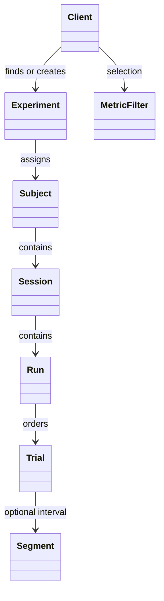

# Objects

| Object | Methods | Data |
| --- | --- | --- |
| `Client` | `metrics()`, `experiments()`, `experiment(name)` or `experiment(id=...)`, `create_experiment(...)` | `username`, `url` |
| `Experiment` | `summary()`, `publish()`, `subject(id)` | `id` |
| `Subject` | `session(id, directory=None)` | `id`, `session_ids`, `experiment` |
| `Session` | `download(directory)`, `run(id="latest")`, `start(takeover=False)`, `finish(status)` | `id`, `run_ids`, `subject` |
| `Run` | `next_trial()`, `media(trial, mode="local")`, `record(trial, status, result=None)` | `id`, `trials`, `results`, `session` |
| `Trial` | None | `trial_id`, `stimulus_id`, `position`, `role`, `media_type`, `segment` |

`Client(username, password, url="https://dbstimuli.com")` signs in immediately.
Use `close()` or a `with` block to discard local credentials.

`Trial`, `Segment`, and `MetricFilter` are frozen dataclasses in `models.py`.
Trial positions are one-based within the run. Roles are `parent`, `repeat`, or
`foil`. A parent can be a full video or an initial half. Segment boundaries
describe the source interval; downloaded halves are ready to play from time zero.
Video is currently the only supported modality.

The server owns assignment order and presentation events. `Run.next_trial()`
reads current progress; an unresolved start raises `ApiError`. Completed runs
return `None` and are not automatically replaced with a subsequent run.
`Run.record()` reports task-observed start/completion, optionally with a JSON
result. It does not play a video or infer attention.

An interrupted/failed session releases its presentation claim. A new client can
reopen it and call `start()`. A still-active claim requires explicit takeover.
An unconfirmed trial remains blocked; review it rather than marking it completed
merely to continue. Started/completed events and result commands are retained
in the server's account database.
`run.results` returns recorded result objects with trial identity, status, receipt
time and request identity. A separate program can bind an existing download using
`subject.session(directory=...)`; the files still undergo checksum verification.
