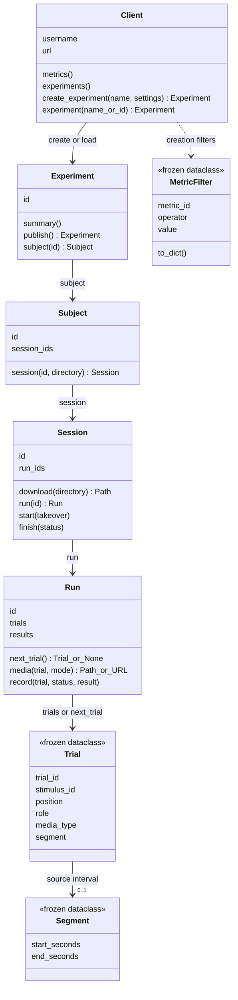

# API objects

Start with `Client(username, password)`. It signs in to **dbstimuli.com**;
`url=` selects another server. Arrows below show how you obtain each object.

Signatures are abbreviated: creation settings are keyword arguments, and lookup
uses `experiment("Exact name")` or `experiment(id="revision-id")`.
Name lookup prefers the latest published revision; ambiguous names require an ID.
Use `Client.close()` or a `with` block when finished.

## What the objects mean

- **Experiment:** saved selection and design; publishing freezes assignments.
- **Subject:** assigned sessions from a published, hash-verified manifest.
- **Session:** download cache and presentation claim; `finish(status)` accepts
  `completed`, `interrupted`, or `failed`.
- **Run:** ordered trials; `next_trial()` reads server progress. `results` is a
  property containing recorded results, not a method.
- **Trial:** immutable assignment, not a player or progress record. Positions
  start at one within each run; roles are `parent`, `repeat`, or `foil`.
- **Segment:** optional source interval. Initial halves and complementary foils
  are already rendered for playback from time zero.
- **MetricFilter:** metric, comparison operator, and threshold used at creation.

`session.run("latest")` selects the most recently started run, or the first if
none started. An unconfirmed start in any run blocks `next_trial()` for the whole
session until reviewed. Otherwise, completed runs return `None`; choose later runs
explicitly.

Workflow classes live in `src/dbstim/workflow.py`, authentication in `client.py`,
and frozen data types in `models.py`. Video is currently the supported modality.
PGL/PsychoPy owns presentation; **the server owns progress**.

[Media and session flow](server-to-local-flow.md)
