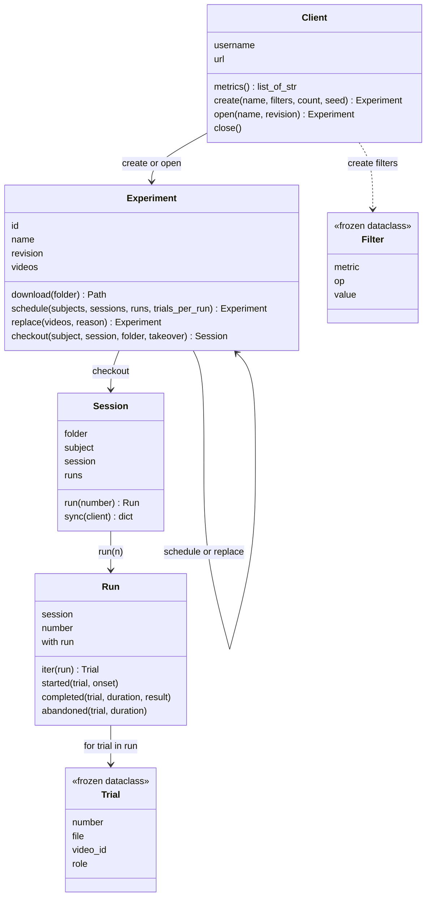

# API objects

`dbstim.connect()` asks for your password and returns a `Client` signed in to
**dbstimuli.com** (`url=` selects another server). Arrows show how you get each
object.

`dbstim.session(folder)` also returns a `Session`, without the network.

## What the objects mean

- **Client:** your signed-in account. Close it with `close()` or a `with`
  block.
- **Experiment:** one frozen revision of a selection. `create()` saves
  revision 1 and refuses a name you already use; `open(name)` gives the
  latest revision, `open(name, revision=2)` an earlier one, and `open(id=...)`
  an exact one. `schedule()` and `replace()` return a new revision and leave
  this one unchanged. `videos` lists catalog ids in manifest order.
- **Session:** one checked-out subject session in a folder. `runs` is the
  tuple of run numbers, such as `(1, 2)`. Opening it and recording never use
  the network; `sync()` does.
- **Run:** one block of trials. Use it in a `with` block; iterating yields the
  trials with no outcome yet, in order. Record each trial `started`, then
  `completed` or `abandoned`; out-of-order calls raise `ValueError`.
- **Trial:** an assigned presentation. `number` counts from 1 in the run,
  `file` is the local movie path, `video_id` the catalog id, and `role` is
  `"video"`, `"repeat"` or `"foil"`. Foil halves are already cut: play them
  from time zero.
- **Filter:** a metric condition such as `Filter("duration_seconds", ">=", 10)`.
  Use `>`, `>=`, `<`, `<=` or `==` with numbers, and `==` or `!=` with
  `True`/`False`. A video must match every filter.

`run.started(trial, onset=...)` takes seconds from your run's time zero.
`run.completed(trial, duration=..., result=...)` takes the seconds shown and
an optional plain-JSON `dict`. Timing accepts NumPy numbers; inside a result,
convert them with `int()` or `float()`. `run.abandoned(trial)` takes an optional `duration`.

## Errors

- `ValueError`: a bad argument, before any request or write.
- `ApiError`: the server refused or failed; `status` is the HTTP code, or
  `None` when the connection failed.
- `SyncError` (an `ApiError`): some runs were refused at sync; see
  [recovery](recovery.md).
- `RuntimeError`: the session is open in another recorder or sync.

Older 0.5 calls (`create_experiment`, `experiment`, `experiments`, `publish`,
`summary`, `MetricFilter`) remain but are not part of this workflow.

[Metric storage and filters](metrics-and-filters.md) · [Data flow](server-to-local-flow.md) · [Recovery](recovery.md)
