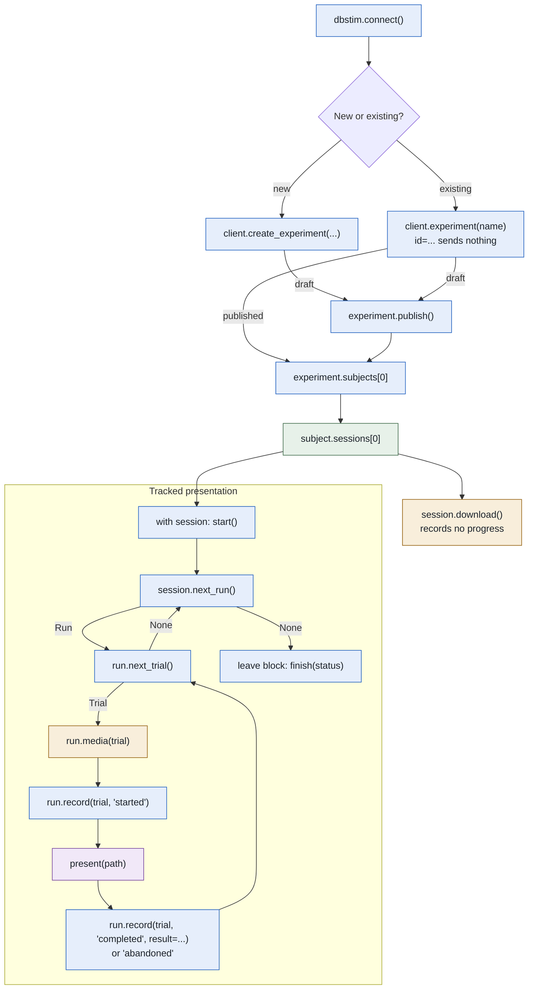
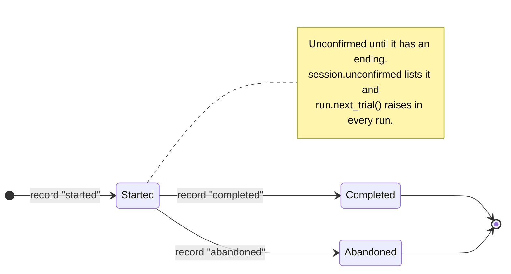

# API map

[api-interface.html](api-interface.html) is the interactive version: download
it and open it in any browser, offline. Both describe dbstim 0.5.0.

Colors: **blue** sends HTTP to dbstimuli.com, **green** stays in your Python
process, **amber** uses the media cache, **purple** is your own code.

Downloading fills the per-user cache (`~/.cache/dbstim`); `run.media(trial)`
then returns a verified file without a request, or downloads that one video if
it is missing. `mode="remote"` returns a short-lived URL instead.

## Trial outcomes

Neither ending is presented again. Leaving `with session:` finishes the session
as `completed` when every trial is completed, `interrupted` after Ctrl-C or when
any trial is abandoned or unfinished, and `failed` after an exception.

## Recovery

- **Stopped mid-trial:** record each of `session.unconfirmed` as `"completed"`
  only if it was shown to the end, otherwise `"abandoned"`.
- **Dropped connection:** `start`, `record` and `finish` are resent unchanged on
  connection failures and HTTP 500, 502, 503 or 504, never on 4xx. If every
  attempt fails, repeat that call on the same session object before any other.
- **Another presenter:** once it has stopped, `session.start(takeover=True)`.

dbstim does not render video, judge whether a trial was seen, write a
standalone manifest, or record progress offline.

[API objects](api-classes.md) · [Data flow](server-to-local-flow.md) · [Recovery](recovery.md)
