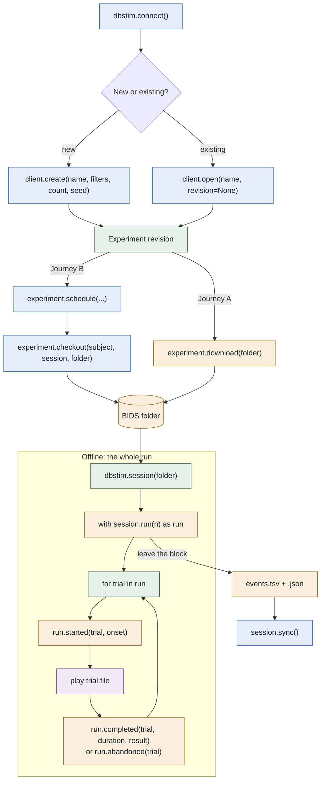
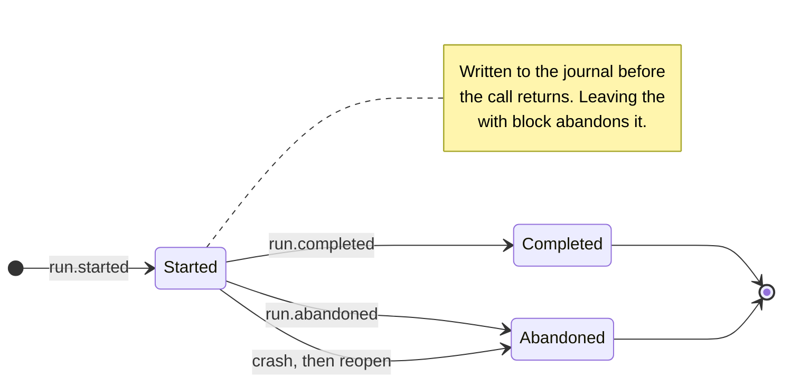

# API map

[api-interface.html](api-interface.html) is the interactive version: download
it and open it in any browser, offline. Both describe dbstim 1.0.0.

Colors: **blue** sends HTTP to dbstimuli.com, **green** stays in your Python
process, **amber** writes files on your computer, **purple** is your own code.

Journey A stops at the folder: videos, `manifest.json` and a PGL-loadable
`manifest.csv` under `stimuli/`. Journey B checks out one subject session to
this computer, records runs with no network, and syncs afterwards.

## Trial outcomes

Neither ending is shown again. A run closes, and can sync, once every trial has
an outcome. `sync()` reports each run as `accepted`, `already synced`,
`kept as flagged attempt` or `waiting`, and raises `SyncError` at the end if the
server refused any.

## Recovery

- **Crash or power cut:** reopen the run on the same computer. The open trial
  becomes `abandoned` and the loop continues.
- **Dropped connection during sync:** run `sync()` again; the same record is
  stored once.
- **Another computer:** `checkout(..., takeover=True)`. The first computer's
  later syncs become flagged attempts.

dbstim does not render video, judge whether a trial was seen, or import PGL.

[API objects](api-classes.md) · [Data flow](server-to-local-flow.md) · [Recovery](recovery.md)
