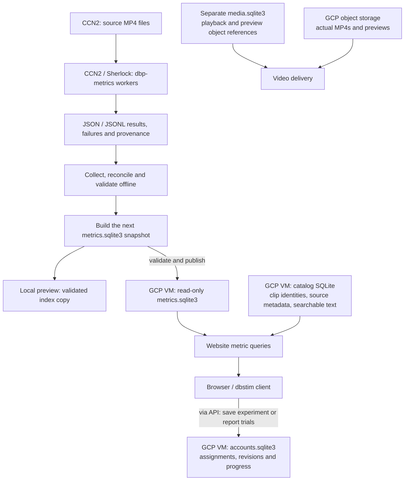
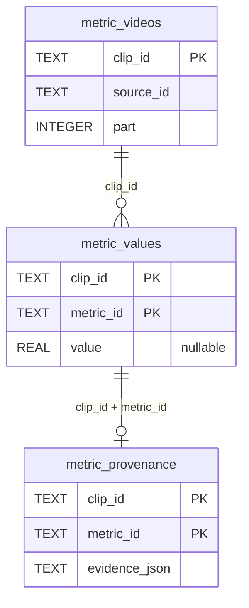

# Metric storage and filtering

**The live metric index is a SQLite file on the website's GCP VM.** CCN2 and
Sherlock compute measurements offline; moving a filter never queries those
clusters.

## Where the data live



These are **separate databases**, not copies of one CCN2 database; cluster
bookkeeping and raw results never serve the website. New values go live only
when a new index is published, not by automatic sync; published assignments stay
fixed.

On the VM the index is `/srv/dbp/metrics/metrics.sqlite3`; the local preview
reads `.local-data/metrics/metrics.sqlite3` in the operator workspace. SQLite
runs inside the website process, not as a PostgreSQL/Cloud SQL service.
Video files live in object storage, not in SQLite.

## Inside the scientific index



The diagram shows logical joins. A clip can have many measurements but at most
one stored value per `(clip_id, metric_id)`. Provenance records the method,
media hash and sampling scope. Other tables hold computation policies, histogram
bins and catalog/version identity. Missing rows or null values mean **unknown**.

## What a filter does

```python
filters = [
    MetricFilter("duration_seconds", ">=", 10),
    MetricFilter("source_view_count", ">=", 100_000),
]
```

1. The API validates each comparison's type, range and operator, then compiles
   parameterized SQL over the stored values.
2. A clip must match every comparison (**AND**); an unknown value fails any
   active comparison. A filter with no threshold is inactive.
3. A batched server-side aggregation recomputes metric distributions over the
   matching **videos**, with the same bins as the full baseline. The browser
   receives aggregates and one page of results, not the whole database.
4. Creating an experiment samples from the eligible matching pool with the
   chosen seed, design and channel rules. A filter match alone does not
   guarantee playable media or assignment eligibility.

Filtering runs no FFmpeg/OCR/VLM computation. `source_view_count` belongs to
the original source video, and its clips inherit it. `client.metrics()` lists
metric definitions, not per-video measurements. Operators `>= <= > <` mean
`gte lte gt lt`; `==` means `eq` for whole numbers. With `True`/`False`,
`==`/`!=` mean `is`/`is_not`.

Code: website `metric_registry.py`, `metric_explorer.py`,
`metric_artifact.py`; `dbp_metrics` produces the worker results.

[API objects](api-classes.md) · [Media and session flow](server-to-local-flow.md)
