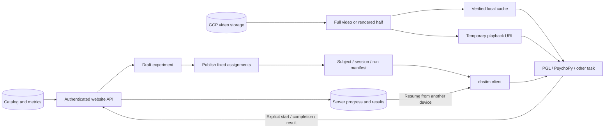

# Assignment and presentation flow

1. Creation selects sources using the saved filters, channel sampling method and
   seed. Publishing freezes each subject's trial order and segment intervals.
2. `Subject` validates the manifest hash. A `Session` exposes only its assigned runs.
3. Downloads verify length and SHA-256 and save a receipt alongside each MP4.
   Remote links authorize one pinned rendition for five minutes and expire on logout.
4. `Session.start()` claims presentation. The task reports each trial before and
   after presenting it; the server acknowledges and stores those events atomically.
5. A reopened session reads server progress. Unconfirmed trials require review;
   downloading or previewing does not count as presentation.

No Google credentials are required on the researcher's computer. Downloaded
files are independent of session progress: deleting the cache does not reset
server records. Optional task results remain attached to immutable server commands.
