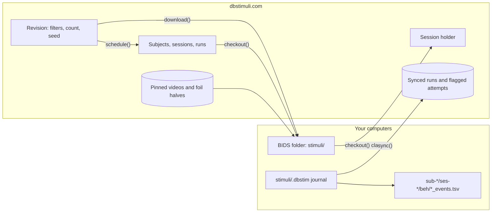
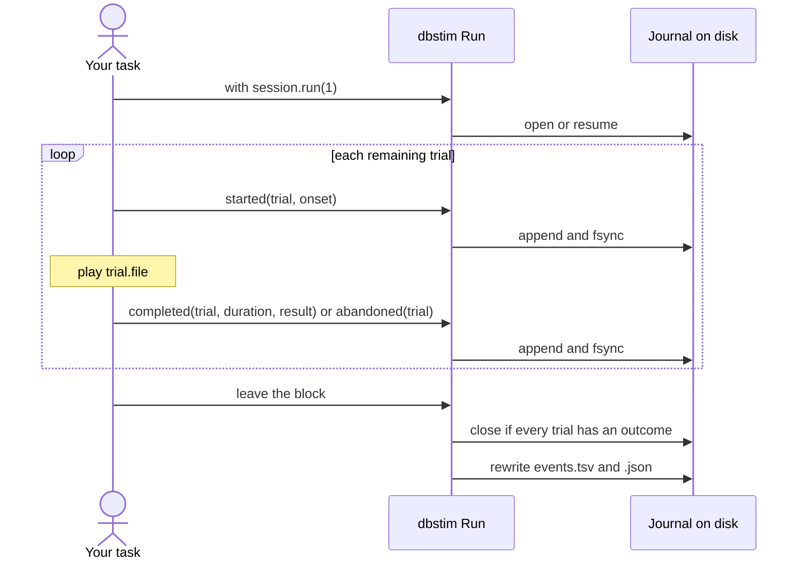

# From experiment to events file

## 1. What the website keeps

An experiment is a frozen selection of videos: filters, count and seed.
`schedule()` and `replace()` save new revisions; earlier revisions stay
reachable with `open(name, revision=n)` or `open(id=...)`. The website also
keeps which computer holds each subject session and every synced run.

## 2. The folder

`download(folder)` and `checkout(...)` write the same layout. Each video is
checked against its size and SHA-256 before it takes its final name, and
verified files already present are reused. A folder that holds another
revision is refused.

| Path | Contents |
| --- | --- |
| `dataset_description.json` | BIDS 1.11.2 name and generator |
| `README` | what the folder holds |
| `stimuli/*.mp4` | the videos; foil halves are separate files |
| `stimuli/manifest.json` | experiment id, revision, filters, seed, and each file's id, size, SHA-256 and duration |
| `stimuli/manifest.csv` | `filename, index, id, sha256, bytes, duration`, one row per movie, for PGL's movie database |
| `stimuli/.dbstim/` | checkout only: run plans, journals, sync receipts |

A checkout holds only that subject session's videos.

## 3. A tracked run

No call in the run uses the network. `sync()` later sends each closed run
once.

## 4. Events columns

Each run gets `sub-01/ses-01/beh/sub-01_ses-01_task-dbstim_run-01_events.tsv`
and a JSON sidecar describing every column:

| Column | Value |
| --- | --- |
| `onset` | seconds from the time zero your code used, as reported |
| `duration` | seconds shown, as reported; `n/a` if unknown |
| `trial_type` | `video`, `repeat` or `foil` |
| `stim_file` | movie name in `stimuli/` |
| `video_id` | catalog video id |
| `planned_duration` | the movie's length from the manifest |
| `outcome` | `completed` or `abandoned` |
| `part` | recording part, from 1; resuming starts a new part |
| `result` | your result as compact JSON, or `n/a` |

dbstim does not check that a video was displayed: `completed` is your code's
claim. `dbstim.frame_summary(presented_times, movie_times, duration)` turns
PGL's per-frame times into `frames_shown`, `frames_dropped`, `seconds_shown`
and `reached_end`, ready to pass as a result. Behavioral responses and PGL's
own data files stay with your task.

[API objects](api-classes.md) · [Recovery](recovery.md) · [Metrics and filters](metrics-and-filters.md)
